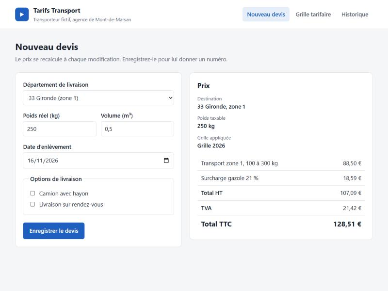
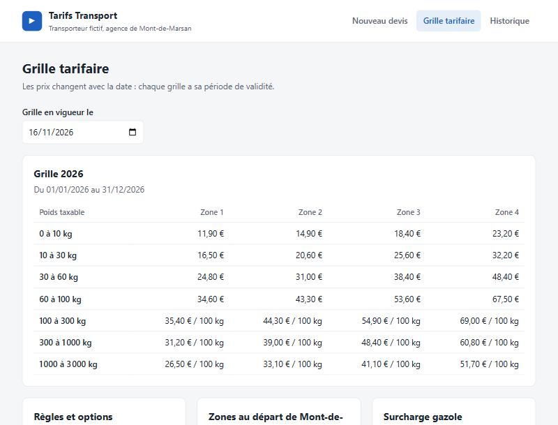

# Tarifs Transport

[](https://github.com/brakan1337/tarifs-transport/actions/workflows/ci.yml)

Moteur de tarification d'un transporteur de messagerie : le commercial saisit une destination, un poids et un volume, et obtient un devis détaillé au centime près.

**Java 21 · Spring Boot 4 · JPA / Hibernate · Flyway · PostgreSQL · Angular 22 · JUnit 5 · Vitest · Docker · GitHub Actions**



## Le brief

> Ce projet est un cas d'étude. Le client est fictif ; le brief sert à justifier les choix techniques.

Un transporteur régional basé à Mont-de-Marsan calcule ses devis à la main, dans un tableur. Les erreurs sont fréquentes : mauvaise grille après un changement de tarif, surcharge gazole appliquée aux options, totaux qui ne tombent pas juste.

Son système d'information est en **Spring Boot et Angular**, et son équipe interne ne maintient rien d'autre. Le nouvel outil doit donc s'intégrer à cette pile.

## Ce que fait l'application

- **Devis en direct** : le prix se recalcule pendant la saisie, puis le devis est enregistré avec un numéro (`DV-2026-00001`).
- **Grilles datées** : chaque grille a sa période de validité. Un enlèvement en 2027 prend automatiquement la grille 2027.
- **Historique** : les devis enregistrés gardent leurs montants, même si la grille change ensuite.
- **Erreurs claires** : département non desservi, poids hors grille, date sans tarif. Chaque cas renvoie un message en français.



## Les règles de calcul

Elles s'appliquent dans cet ordre, dans [`MoteurTarif`](backend/src/main/java/io/github/brakan1337/tarifs/moteur/MoteurTarif.java) :

1. **Poids taxable** : le plus lourd entre le poids réel et le volume × 250 kg/m³, arrondi au kilo supérieur. Un colis léger mais encombrant paie la place qu'il prend.
2. **Tranche** : la zone de destination (1 à 4) et le poids taxable désignent une ligne de la grille. Prix forfaitaire jusqu'à 100 kg, prix aux 100 kg au-delà.
3. **Poids de bascule** : si le minimum de la tranche suivante coûte moins cher, on facture ce minimum. Sans cette règle, 290 kg coûteraient 102,66 € et 300 kg seulement 93,60 €.
4. **Minimum de perception** : aucun transport ne descend sous ce montant.
5. **Surcharge gazole** : un pourcentage publié chaque mois, appliqué au transport seul, jamais aux options.
6. **Options** : livraison avec hayon, livraison sur rendez-vous.
7. **TVA**.

Exemple : 290 kg vers la Gironde, avec hayon, en novembre 2026.

| Ligne | Montant |
|---|---:|
| Transport zone 1, 300 à 1 000 kg, au poids de bascule 300 kg | 93,60 € |
| Surcharge gazole 21 % | 19,66 € |
| Livraison avec hayon | 28,00 € |
| **Total HT** | **141,26 €** |
| TVA 20 % | 28,25 € |
| **Total TTC** | **169,51 €** |

## Choix techniques

- **Le moteur ne dépend de rien.** Le package `moteur` ne connaît ni Spring ni la base de données. Il reçoit une grille et une expédition, et rend un calcul. Il se teste en quelques millisecondes.
- **`BigDecimal` pour tous les montants**, jamais `double` : 0,1 + 0,2 doit faire 0,3.
- **Arrondi ligne par ligne.** Chaque ligne est arrondie au centime, puis le total additionne les lignes arrondies. Le client retrouve toujours le total en additionnant ce qu'il lit.
- **Flyway crée le schéma, Hibernate le vérifie** (`ddl-auto=validate`). Une entité qui ne correspond plus à la table empêche l'application de démarrer.
- **Erreurs au format standard** Problem Details (RFC 9457), avec le détail champ par champ pour le formulaire.
- **Simulation sans écriture.** `POST /api/devis/simulation` calcule sans rien enregistrer. L'écran s'en sert pendant la saisie et annule la requête précédente à chaque frappe (`switchMap`).
- **H2 pour essayer, PostgreSQL pour de vrai.** Sans rien installer, l'application démarre sur une base en mémoire. La CI rejoue les mêmes tests sur un vrai PostgreSQL.

## Architecture

```
backend/   Spring Boot
  moteur/       le calcul, en Java pur
  donnees/      entités JPA et dépôts
  devis/        service et API des devis
  referentiel/  départements, grilles, indices gazole
  web/          erreurs, configuration, routage de l'interface
  resources/db/migration/   schéma et données de démonstration (Flyway)
frontend/  Angular : nouveau devis, grille, historique, détail
```

## L'API

| Méthode | Adresse | Rôle |
|---|---|---|
| `POST` | `/api/devis/simulation` | calcule un prix sans l'enregistrer |
| `POST` | `/api/devis` | enregistre un devis et renvoie son numéro |
| `GET` | `/api/devis` | les 20 derniers devis |
| `GET` | `/api/devis/{numero}` | un devis |
| `GET` | `/api/grilles/en-vigueur?date=2026-11-20` | la grille applicable à une date |
| `GET` | `/api/departements` | les départements et leur zone |
| `GET` | `/api/indices-gazole` | les taux de surcharge publiés |

```bash
curl -X POST localhost:8080/api/devis/simulation -H "Content-Type: application/json" \
  -d '{"departement":"33","poidsKg":290,"volumeM3":0.5,"dateEnlevement":"2026-11-20","hayon":true,"rendezVous":false}'
```

## Lancer le projet

**Avec Docker** (PostgreSQL compris) :

```bash
docker compose up --build
```

puis http://localhost:8080.

**Sans Docker**, avec Java 21 et Node 24 :

```bash
cd backend && ./mvnw spring-boot:run
```

```bash
cd frontend && npm install && npx ng serve
```

puis http://localhost:4200. Le serveur Angular redirige `/api` vers le port 8080.

## Tests

```bash
cd backend && ./mvnw test
```

```bash
cd frontend && npx ng test --watch=false
```

- **Moteur** : 18 tests unitaires sur les règles de calcul (bornes de tranche, poids volumétrique, bascule, minimum, arrondis).
- **API** : 11 tests sur l'application complète (enregistrement, relecture, grille 2027, erreurs 400, 404 et 422).
- **Interface** : 6 tests Vitest (formatage des montants, affichage de la grille).

La CI lance tout à chaque push, rejoue les tests Java sur PostgreSQL et construit l'image Docker.
